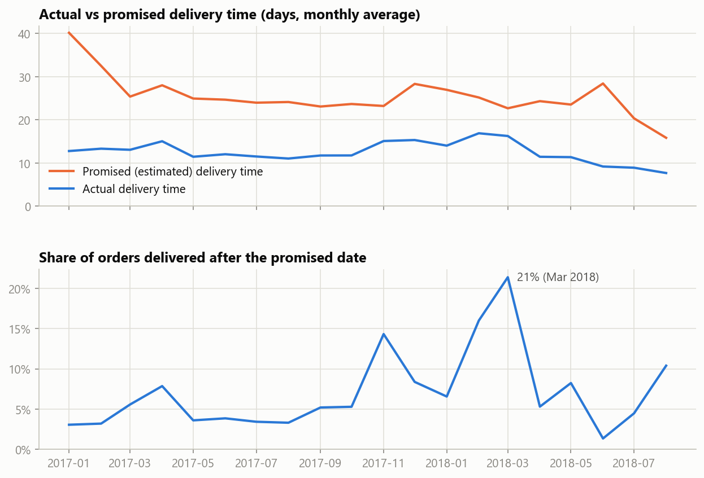
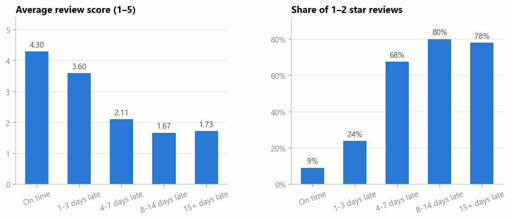
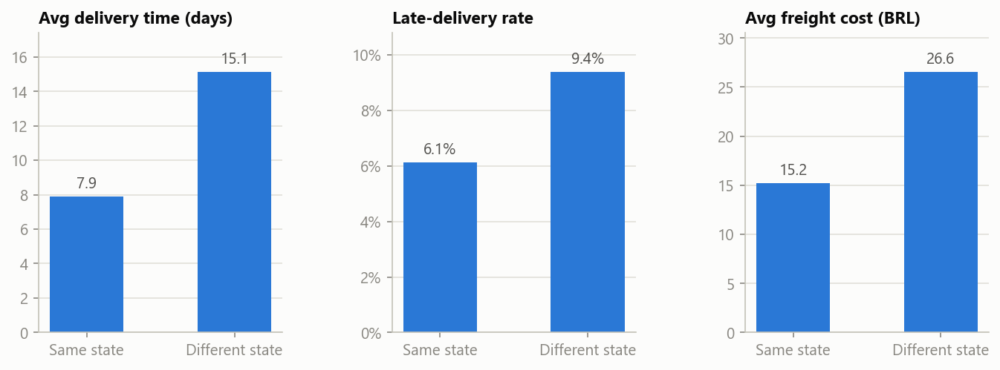
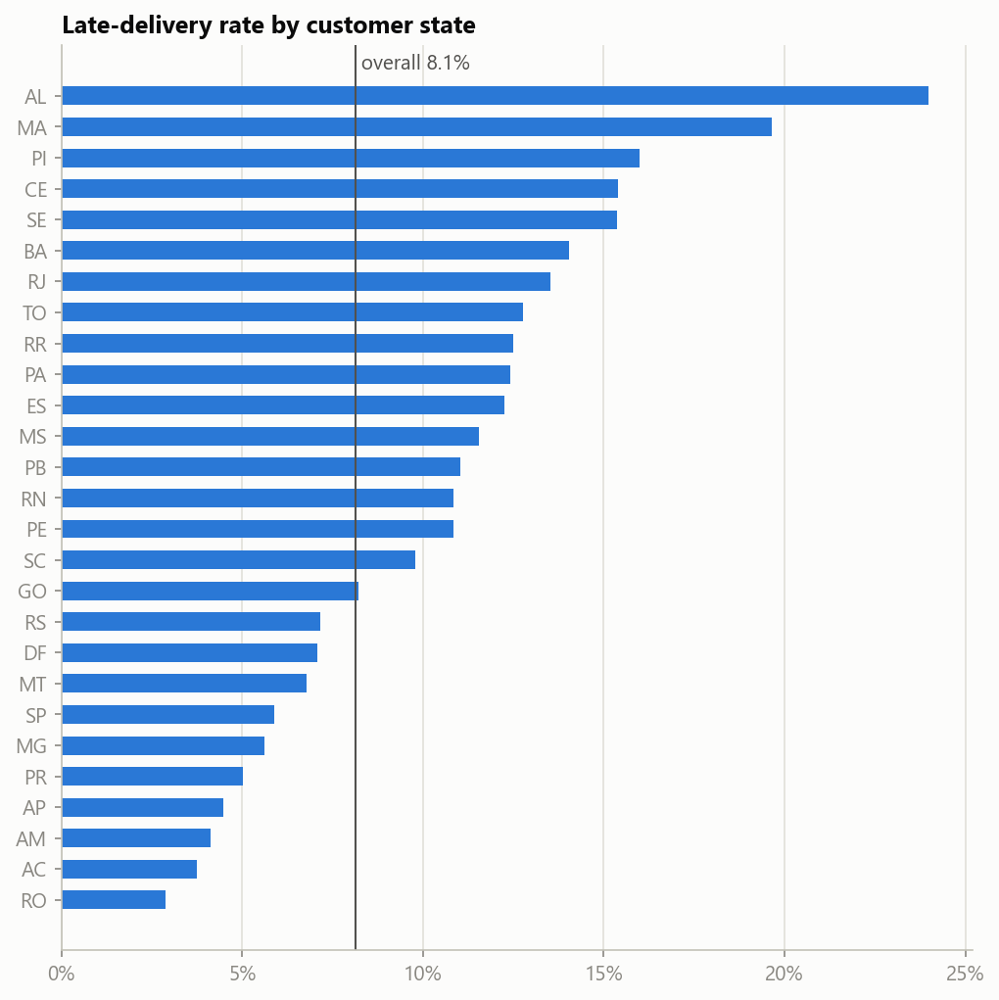
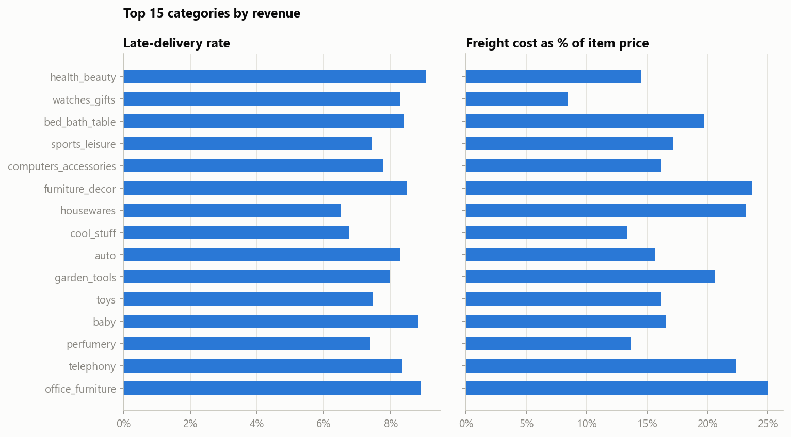

# Olist Supply Chain Analysis (PySpark & KNIME)

Ad hoc analysis of delivery performance in the [Olist Brazilian E-Commerce dataset](https://www.kaggle.com/datasets/olistbr/brazilian-ecommerce): about 96k delivered orders across 7 joined tables, January 2017 – August 2018.

**Main notebook:** [`notebooks/supply_chain_analysis.ipynb`](notebooks/supply_chain_analysis.ipynb)

## Questions and findings

| # | Question | Finding |
|---|---|---|
| 1 | How did delivery performance change over time? | Late deliveries spike in peak periods: **14%** in Nov 2017 (Black Friday) and **21%** in Mar 2018, compared with a 3–5% baseline |
| 2 | Which states get the slowest deliveries? | North-eastern states have **2–4× the late rate** of São Paulo (AL 24% vs SP 5.9%). Rio de Janeiro, the 2nd-largest market, has a late rate of 13.5% |
| 3 | Does seller–customer distance matter? | Same-state orders arrive in **7.9 days instead of 15.1**, and freight costs 43% less |
| 4 | Do delays hurt satisfaction? | Average review score falls from **4.30** (on time) to **2.11** (4–7 days late), and 68% of those late orders get 1–2 star reviews |
| 5 | Which categories are most affected? | Late rates are similar across categories (6.5–9.1%). Freight cost ranges from 8% to 25% of the item price |

### Delivery time and late rate over time


The promised delivery window shrank from about 28 days to about 16 days in mid-2018. Actual deliveries got faster, but they did not keep up with the shorter promises, so the late rate rose again.

### Late deliveries and review scores


### Same-state vs cross-state orders


<details>
<summary>More charts: states and categories</summary>




</details>

### Recommendations
- Add carrier capacity, or add buffer to the promised dates, before peak periods (Black Friday, February–March).
- Review carrier performance on the routes to Rio de Janeiro and the north-east, and evaluate a regional fulfilment point there.
- Increase the share of same-state orders by recruiting sellers outside São Paulo or routing orders to the nearest seller.
- Contact customers proactively when an order is expected to be more than 3 days late, since that is where review scores collapse.

## What the notebook covers

- **Data quality checks:** missing values, duplicates, and multi-line review text. Read with default options, the review file inflates from 99,224 to 104,162 rows, so it is parsed with `multiLine=True`.
- **Joins:** orders, order items, customers, sellers, products, categories and reviews are combined into one table with a row per delivered order.
- **PySpark DataFrame API:** `filter`, `withColumn`, `when/otherwise`, `datediff`, `date_trunc`, `groupBy/agg`, `cache`.
- **Spark SQL:** the state analysis is written again in SQL and checked against the DataFrame API result.
- **Visualisation:** aggregated results are converted with `toPandas()` and plotted with matplotlib.

## Project structure

```
├── notebooks/
│   └── supply_chain_analysis.ipynb   # main analysis
├── images/                           # charts used in this README
├── knime/
│   └── olist_analiz.knwf             # KNIME workflow: CSV Reader → Row Filter / GroupBy
├── learning/                         # step-by-step PySpark exercises (ders = lesson)
└── requirements.txt
```

## How to run

1. Download the dataset from [Kaggle](https://www.kaggle.com/datasets/olistbr/brazilian-ecommerce) and put the CSV files in a `data/` folder. The data is not included in this repository.
2. Install Java 17 and the Python dependencies:
   ```
   pip install -r requirements.txt
   ```
3. Open `notebooks/supply_chain_analysis.ipynb` in Jupyter or VS Code and run all cells.

To open the KNIME workflow, use **File → Import KNIME Workflow** in KNIME Analytics Platform 5.x and point the CSV Reader node to your `data/olist_orders_dataset.csv`.
